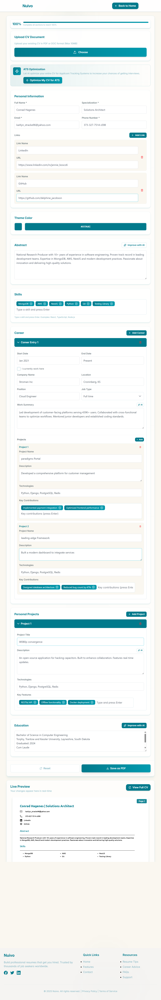
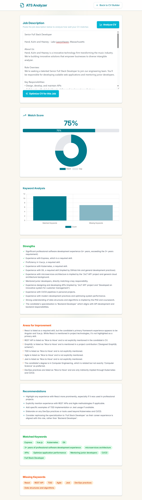

# Nuivo: AI-Powered CV Builder with ATS Optimization 📄✨

**Build a CV that gets past Applicant Tracking Systems, on the web or on your phone.**

Nuivo helps job seekers write better CVs with **Google Gemini AI**, checks how well a CV matches a job description (an ATS score from 0 to 100), suggests specific improvements, and exports a polished PDF. CVs are saved to the user's account in the cloud.

*Graduation project, Bachelor of Information Technology, IUST.*

<!-- Live demo: add your Netlify link here -->

<p align="center">
  
  
</p>

---

## ✨ Features

**🤖 AI writing help (Gemini)**<br>
Eight specialized AI hooks: summary improvement, career descriptions, education achievements, project descriptions, **resume parsing from uploaded PDF/Word files**, ATS analysis, CV optimization and keyword extraction.

**📊 ATS analysis**<br>
Paste a job description and get a match percentage, missing keywords, strengths and weaknesses.

**🛠️ AI optimization**<br>
Suggestions grouped by section, each with current text, an improved version and an impact level (high / medium / low). Pick which ones to apply, preview them, and re-analyze.

**🎨 Multi-template CV builder**<br>
Three professional templates with a live, paginated A4 preview. Switch templates at any time without losing data.

**📄 PDF export**<br>
High-quality export on the web (react-to-print) and native PDF export and sharing on mobile (expo-print + expo-sharing).

**🔐 Accounts and cloud storage**<br>
Email/password and **Google sign-in**, email verification, password reset, and multiple CVs per user stored in **Cloud Firestore**.

**🛡️ Admin dashboard**<br>
Platform statistics, a user management table, and block/unblock enforced by **Firestore security rules** rather than only hidden in the UI.

**📱 Mobile app (iOS & Android)**<br>
A complete React Native (Expo) app with 12 screens and full feature parity with the web, plus drawer and tab navigation and dark mode.

**🔑 Secure AI calls**<br>
Every Gemini request goes through a **Netlify serverless function**, so the API key never reaches the browser or the phone.

---

## 🏗️ Architecture

```
Web (React + Vite)  ─┐
                     ├──►  Netlify Function (Gemini proxy)  ──►  Google Gemini API
Mobile (Expo / RN)  ─┘
         │
         └──►  Firebase Authentication + Cloud Firestore (security rules)
```

Shared design across both clients: React Context for state (Auth, CV, Theme, Toast) and the same AI hooks.

---

## 🧰 Tech Stack

| Area | Tools |
|------|-------|
| Web | React 19, TypeScript, Vite, Tailwind CSS, PrimeReact, React Router, React Hook Form, Framer Motion, Chart.js |
| Mobile | React Native, Expo, NativeWind, React Navigation |
| AI | Google Gemini API |
| Backend | Firebase Authentication, Cloud Firestore, Netlify Functions |
| Files | pdf.js and Mammoth (CV parsing), react-to-print, expo-print |
| Testing | **Cypress** end-to-end tests: sign in → build CV → ATS analysis → export |

---

## 🚀 Getting Started

### Web app
```bash
cd apply-right-web
npm install
cp .env.example .env      # then add your GEMINI_API_KEY (server-side only)
npm run dev
```

Run the end-to-end tests:
```bash
npm run cypress-open      # interactive
npm run cypress-run       # headless
```

### Mobile app
```bash
cd apply-right-app
npm install
npx expo start            # scan the QR code with Expo Go
```

> You'll need your own Firebase project and Gemini API key. Get a free Gemini key from [Google AI Studio](https://aistudio.google.com/).

---

## 📁 Project Structure

```
apply-right/
├── apply-right-web/     # React + Vite web app, Netlify function, Cypress tests
└── apply-right-app/     # React Native (Expo) mobile app
```

---

## 👥 Team

- **Sariya Al Jaber**: [@eng-sariya1](https://github.com/eng-sariya1) · sariajabr@gmail.com
- **Roaa Almasalma**: [@roamas](https://github.com/roamas)
